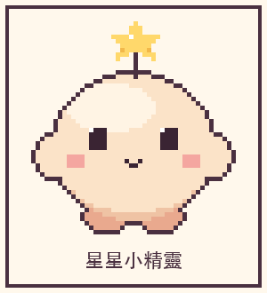
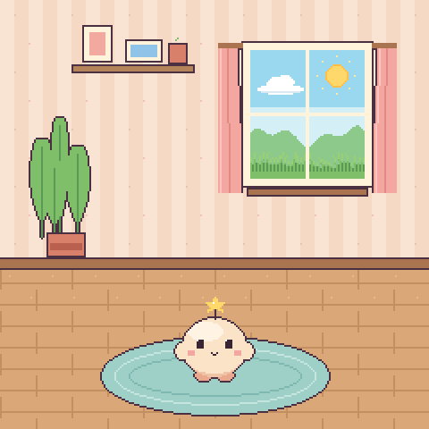
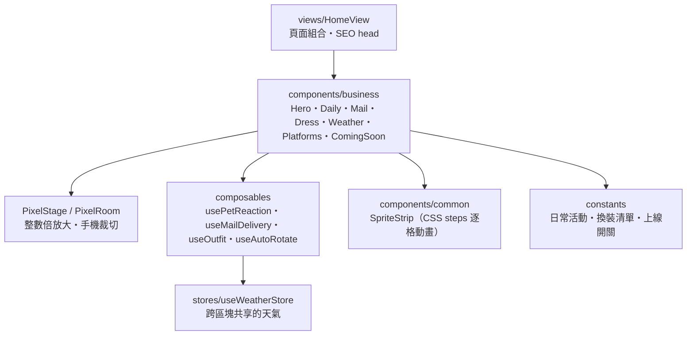

<div align="center">

# 小伴星 PixelMate

**一隻會陪你生活、陪你成長，也會幫你把心意送到遠方的像素小夥伴**

*8-bit Pixel Pet・Cozy Room・Letters from Far Away*




</div>

---

## 📖 簡介

小伴星 PixelMate 是一款 8-bit 像素風虛擬寵物。這個 repo 目前是它的**預告官網**（M1）：一頁式、可互動的像素小世界，讓第一次進站的人 5 秒內理解「這是一隻會自己生活、也會替你送信的小夥伴」。

> 💡 官網中的互動（點寵物、送信、換裝、切換天氣）皆為**示範預覽**，不代表 PWA 或桌面裝置已上線；CTA 目前顯示「即將開放」。

<div align="center">



</div>

## ✨ 功能特色

- 🏠 **會呼吸的像素小房間** — 逐格動畫的角色、風吹過的草、搖擺的盆栽與窗簾
- 🌦️ **窗外的天氣會動** — 晴天（雲飄、太陽閃）、雨天（雨滴、水波、閃電）、夜晚（星星、月亮、螢火蟲）
- 🗓️ **牠有自己的日常** — 午睡、看書、看雨、撿禮物、喝珍奶、吃雞排、坐在消波塊上看海
- ✉️ **遠方的心意** — 點信箱 → 小郵差跑來送信 → 打開示範信件
- 🎩 **長成獨一無二的模樣** — 草帽、毛線帽、藍圍巾、藍白拖，圖層與角色動畫同步
- 📱 **兩個地方都找得到牠** — 手機 PWA 與桌面小螢幕預告
- 🇹🇼 **台灣味** — 珍珠奶茶、雞排、藍白拖、消波塊
- ♿ **友善** — 手機 360px 無橫向捲動、點擊區 ≥ 44px、尊重「減少動態」、鍵盤可操作

## 🏗️ 系統架構



遵守 `docs/frontArchitecture.md`：View 管頁面流程、Component 管 UI、Composable 管可重用的狀態與副作用、Store 只放真正共享的狀態。官網目前**沒有後端，不需要 BFF**，也就沒有 API Module / HTTP Client 層。

## 🧰 技術棧

| 類別 | 技術 |
| --- | --- |
| 前端 | Vue 3、TypeScript、Vue Router、Pinia |
| 建置 | Vite、vite-ssg（預先產生靜態 HTML）、beasties（內嵌 CSS） |
| 動畫 | 純 CSS `steps()` 逐格動畫（不使用巨型 GIF） |
| 測試 | Vitest + jsdom（單元）、Playwright（E2E，桌機 1440px / 手機 360px） |
| 素材 | Python + Pillow 程式化繪製的原創像素圖（暫用素材） |
| SEO / GEO | meta / Open Graph / JSON-LD、`robots.txt`、`llms.txt`、sitemap |

## 📂 專案結構

```text
apps/web/                  官網（Vue 3 + vite-ssg）
  src/views/               HomeView
  src/components/business/ 各區塊與像素場景
  src/components/common/   SpriteStrip、StatusBadge
  src/composables/         互動與狀態邏輯
  src/stores/              useWeatherStore
  src/constants/           活動、換裝、上線開關
  src/assets/pixel/        像素圖（由 tools 產生）
  e2e/                     Playwright 測試
  nginx/                   容器內靜態站設定範本
tools/pixel-art/           像素素材產生腳本（pet / room / world / ...）
assets/readme/             README 用的 GIF（由 tools/pixel-art/readme_gifs.py 產生）
```

`docs/`（內部規格）與部署設定不進版本控制。

## 🚀 啟動

```bash
cd apps/web
cp .env.example .env      # 可選：填入 VITE_SITE_URL，會產生 canonical / sitemap
npm install
npm run dev               # 開發伺服器
npm run build             # 型別檢查 + 靜態產出至 dist/
npm run preview           # 預覽建置結果
```

## 🎨 重新產生素材

```bash
python3 -m pip install pillow
cd tools/pixel-art
A=../../apps/web/src/assets/pixel
python3 pet.py $A && python3 room.py $A && python3 world.py $A
python3 activities.py $A && python3 yard.py $A && python3 taiwan.py $A
python3 accessories.py $A && python3 devices.py $A
python3 readme_gifs.py $A ../../assets/readme   # README 的角色與房間 GIF
python3 brand.py $A ../../apps/web/public   # favicon / touch icon / OG 封面
```

素材為**暫用原創**，上線前會換成正式版本；不使用任何他人角色或美術。

## ⌨️ 互動

| 操作 | 行為 |
| --- | --- |
| 點寵物 | 眨眼、開心跳動並說一句示範短句 |
| 日常分頁 | 點選或用方向鍵切換；使用者操作後停止自動輪播 |
| 點信箱 | 小郵差送信；信到後點信封開信，`Esc` 關閉 |
| 換裝按鈕 | 帽子互斥、可疊穿圍巾與藍白拖；再點一次脫下 |
| 天氣切換 | 晴天 / 雨天 / 夜晚，角色行為與窗外動畫同步改變 |

## 🛠️ 開發

```bash
npm test                  # 單元測試（Vitest）
npx playwright test       # E2E（會自動 build + preview）
npx vue-tsc -b            # 型別檢查
```

- 開放 PWA 時，將 `src/constants/launch.ts` 的 `IS_APP_OPEN` 改為 `true`，CTA 會切成「開始養一隻」。
- 部署設定（主機、路徑、埠、反向代理）屬部署機密文件，**不進版本控制**；repo 只保留建置用的 `Dockerfile` 與容器內 Nginx 範本，監聽埠由環境變數 `PORT` 提供。
- 密鑰與 `.env` 不提交。

## 🌿 Git Flow

`main` ← `develop` ← `feature/frontend/*`；錯誤修復使用 `bug/*`，完成後合併回 `develop`。
一個功能一個分支：開發、單元測試、整合測試完成後合併回 `develop`，下一個功能再從 `develop` 開新分支。
不推送 `.env`、`docs/` 與機密資料。
